<h1 align="center">Hi, I'm Bruno 👋</h1>

  <b>Software Engineer at StoneCo</b> · Computer Engineering at PUC-Rio · Rio de Janeiro, Brazil

  
  

---

### About me

- 💳 I build payment systems on the **Payments Finance** team at **StoneCo**, one of Brazil's largest payment processors.
- ⚙️ Right now I'm building the service that **splits one payment among many merchants, atomically**, on Go, Kafka and DynamoDB.
- 📦 I wrote and maintain [**tariklabs/mapper**](https://github.com/tariklabs/mapper), an open-source Go library for mapping structs with zero boilerplate.
- 🚀 I co-founded two startups: **Sweep**, a ticketing platform built to fight scalping, and **Sample School**, an AI platform that helped 30 teachers cut their exam workload by 80%.

### Tech stack

  

### Featured projects

  
  
   
  
  

### GitHub stats

  <picture>
    <source media="(prefers-color-scheme: dark)" srcset="./profile/stats-dark.svg"/>
    
  </picture>
  <picture>
    <source media="(prefers-color-scheme: dark)" srcset="./profile/top-langs-dark.svg"/>
    
  </picture>

Most of my commits and PRs are in private repositories, so they don't show up in these numbers.

